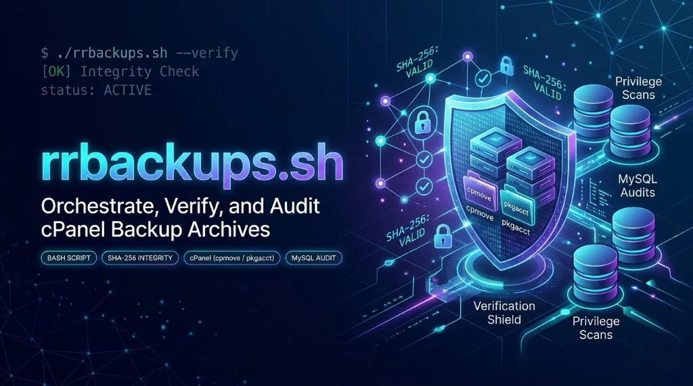

[](README.md) [](README-ptbr.md) [](README-es.md)

# rrbackups



[](https://github.com/sr00t3d/rrbackups/releases/tag/v2.0.0)
[](LICENSE)
[](#requisitos)
[](#requisitos)

**Orquestador Seguro de Backups, Verificación y Restauración de Resellers cPanel/WHM.**

`rrbackups.sh` descubre, deduplica y verifica archivos de respaldo cPanel (`cpmove-*.tar.gz`, `backup-*.tar.gz`), genera backups `chmod 600` con `manifest.json` SHA-256 mediante `/scripts/pkgacct`, restaura de forma segura preservando `OWNER`/`PLAN` y audita privilegios `SUPER`/`GRANT`/`FILE` en MySQL/MariaDB (`audit-mysql`).

> **Inspiración Histórica:** Reimplementación limpia en Bash + Python 3.6+ (`v2.0.0`) inspirada en `rrbackups` (2011–2012, v1.0.3, Mark Shields, HostGator.com, LLC).

---

## Ejecución Directa

```bash
curl -fsSL https://raw.githubusercontent.com/sr00t3d/rrbackups/main/rrbackups.sh -o rrbackups.sh
chmod +x rrbackups.sh
sudo ./rrbackups.sh scan --dir /backup/accounts --verify
```

---

## Ejemplo de Salida Real

```text
==================================================================================================
 rrbackups.sh v2.0.0 | Scan | /var/backups/rrbackups/20261122 | 2026-11-22T11:38:13Z
==================================================================================================
USER    ROLE       SIZE      EXISTS  OWNER  VERIFY   ARCHIVE
------  ---------  --------  ------  -----  -------  ----------------------------------------
broken  PRIMARY    16 B      NO      -      CORRUPT  cpmove-broken.tar.gz
percio  PRIMARY    1.50 KiB  YES     root   VALID    cpmove-percio.tar.gz
percio  DUPLICATE  1.50 KiB  YES     root   VALID    backup-11.20.2026_01-00-00_percio.tar.gz

Summary: 3 archive(s) | 2 unique account(s) | 2 warning(s)
```

---

## Licencia

Licenciado bajo [Apache License 2.0](LICENSE).
