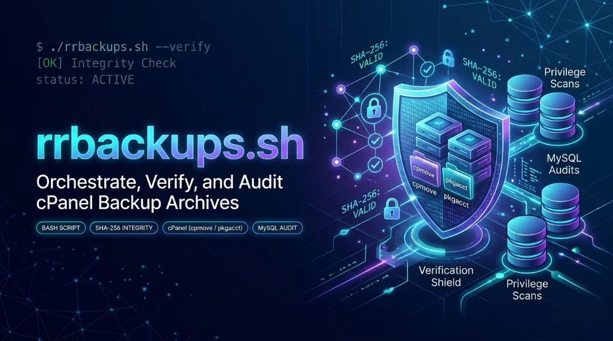

[](README.md) [](README-ptbr.md) [](README-es.md)

# rrbackups



[](https://github.com/sr00t3d/rrbackups/releases/tag/v2.0.0)
[](LICENSE)
[](#requisitos)
[](#requisitos)

**Orquestrador Seguro de Backup, Verificação e Restauração de Contas e Revendas cPanel/WHM.**

O `rrbackups.sh` descobre, deduplica e valida integridade de backups cPanel (`cpmove-*.tar.gz`, `backup-*.tar.gz`) em modo `scan` somente-leitura, executa backups `chmod 600` com `manifest.json` SHA-256 via `/scripts/pkgacct`, orquestra restaurações seguras com verificação prévia de integridade e preservação de `OWNER`/`PLAN`, além de auditar privilégios `SUPER`/`GRANT`/`FILE` indevidos no MySQL/MariaDB (`audit-mysql`).

> **Inspiração Histórica:** Reimplementação limpa em Bash + Python 3.6+ (`v2.0.0`) inspirada no clássico `rrbackups` (2011–2012, v1.0.3, Mark Shields, HostGator.com, LLC).

---

## Execução Direta

```bash
curl -fsSL https://raw.githubusercontent.com/sr00t3d/rrbackups/main/rrbackups.sh -o rrbackups.sh
chmod +x rrbackups.sh
sudo ./rrbackups.sh scan --dir /backup/accounts --verify
```

---

## Exemplos de Uso

```bash
sudo ./rrbackups.sh scan --dir /var/backups/rrbackups/20261122 --verify
sudo ./rrbackups.sh backup --user percio --dest /var/backups/rrbackups
sudo ./rrbackups.sh restore /var/backups/rrbackups/20261122/cpmove-percio.tar.gz --dry-run
sudo ./rrbackups.sh audit-mysql --exit-code
```

---

## Licença

Distribuído sob a licença [Apache License 2.0](LICENSE).
